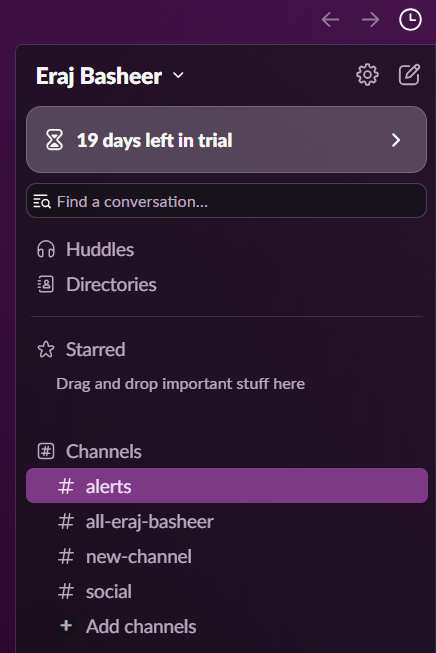
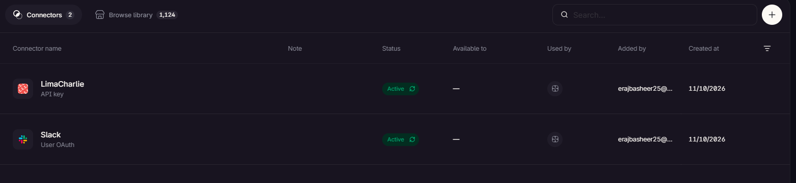
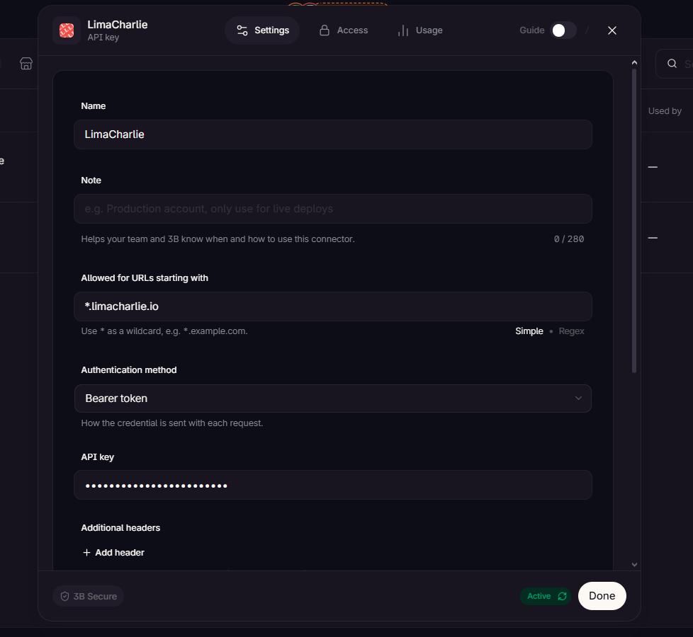
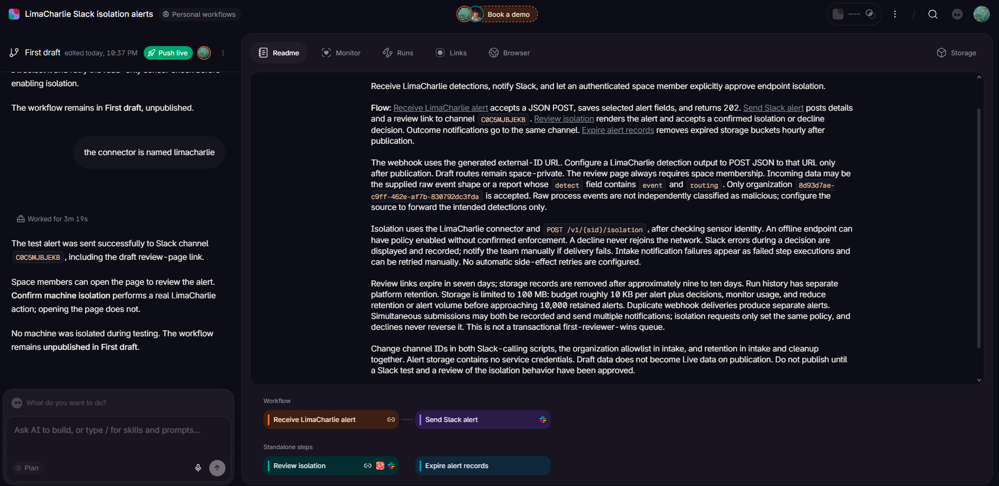
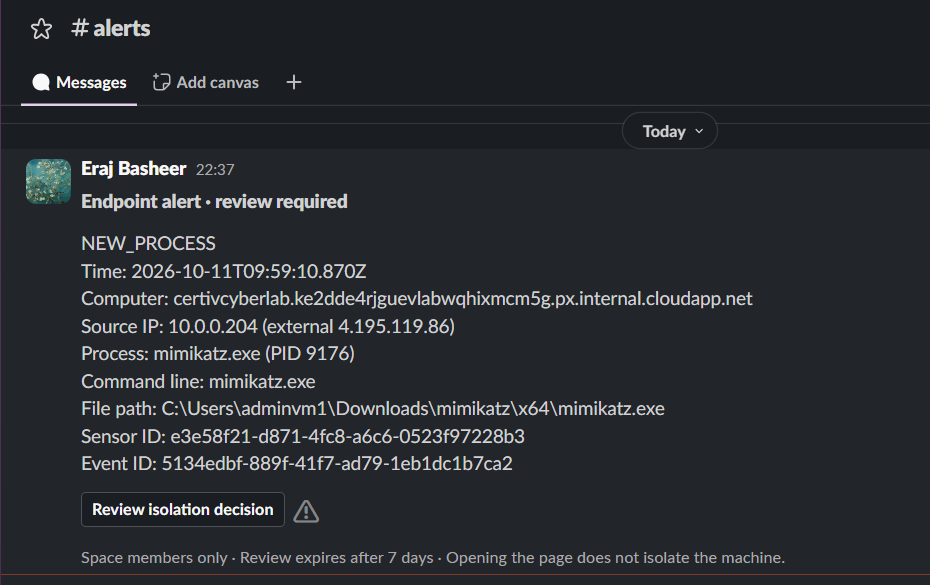
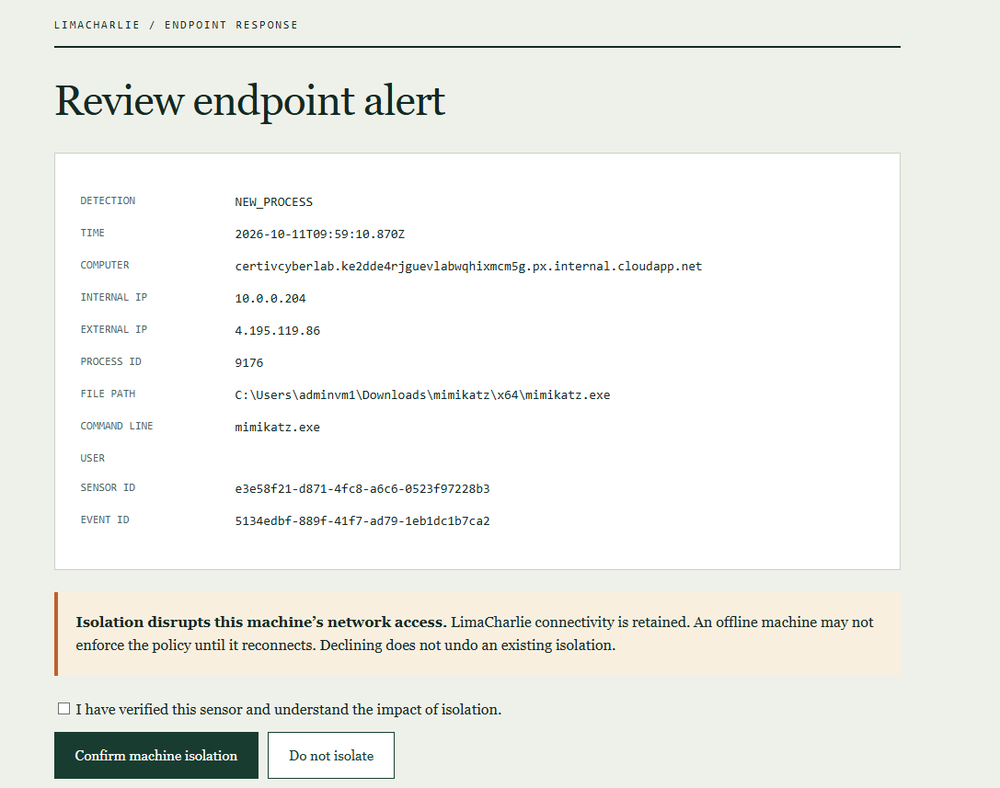

# LimaCharlie EDR and SOAR

## Overview 

This lab involved configurating a detection rule in LimaCharlie (EDR) in order to detect Mimikatz execution on a Windows endpoint, following which a playbook established in Tines recieves the alert information and sends a message to Slack with the details of the alert and a prompt which provides the option to isolate the machine, whereby the machine is automatically isolated by LimaCharlie.

## Objectives 

- Setup LimaCharlie Organisation and connect Windows 10 Sensor
- Run Mimikatz and Create Detection and Response Rule for Mimikatz
- Create Slack Alerts channel
- Create Tines account and add Slack and LimaCharlie Connectors
- Create Tines workflow
- Test workflow


## Lab Diagram

 
<br>

--- 

## 1. LimaCharlie Setup

After creating a LimaCharlie account, create an organisation and enter in the relevant details. In order to attach the Windows 10 virtual machine as a sensor, click Add Sensor (on the Sensors page) and select the Windows sensor type. Select the organisation's Installation Key and run the powershell command given to add the sensor.

 
 
 
<br>

## 2. Mimikatz Detection 


In order to build the Detection and Response rule, we first need to generate telemetry related to Mimikatz. 

Use git to clone Mimikatz from the (offical repositiory)[https://github.com/ParrotSec/mimikatz.git]. After running Mimikatz, run the following commands:

``` 
privilege::debug
```

```
sekurlsa::logonPasswords
```

 
 
<br>

The event logs generated from running Mimikatz can be viewed by clicking the sensor attached earlier and then selecting the Timeline page. Search for Mimikatz to find related logs.

 
<br>

Based on the information gathered from the mimikatz event, we can build the Detection and Response rule. Open the detections page. Following LimaCharlie documentation, create and enable the following rule:

```
events:
  - NEW_PROCESS
  - EXISTING_PROCESS
op: and
rules:
  - op: is windows
  - op: or
    rules:
      - case sensitive: false
        op: ends with
        path: event/FILE_PATH
        value: mimikatz.exe

      - case sensitive: false
        op: contains
        path: event/COMMAND_LINE
        value: mimikatz

- action: report
  metadata:
    author: Eraj Basheer
    description: Detects potential Mimikatz execution
    falsepositives:
      - Security testing and lab simulations
    level: high
    tags:
      - attack.credential_access
      - attack.t1003
  name: Credential Dumper - Mimikatz

```
<br>


## 4. Tines Automation

### Slack Setup 

In order to recieve notifications in regards to alerts, setup of a Slack account is required. Create a Slack account and create a new channel named Alerts.


 
<br>

### Tines Setup

Create a Tines account. On the connectors page, add Slack and LimaCharlie as connectors. Connect the Slack Alerts channel using the Channel ID and connect LimaCharlie using the Organisation JWT.

 
 
 

<br>

## Tines Workflow

To create the SOAR playbook, select personal workflows in Tines and describe the automation process to the Tines 3B AI tool. Attach the project diagram and use the following prompt:

``` Create a web hook from LimaCharlie to Tines with details of a detection, that then sends a message to Slack with the same details. Then create a web page message that gets sent to Slack that allows the machine to be isolated in LimaCharlie ```


<br>

## 4. Testing

 
 

## Conclusion
