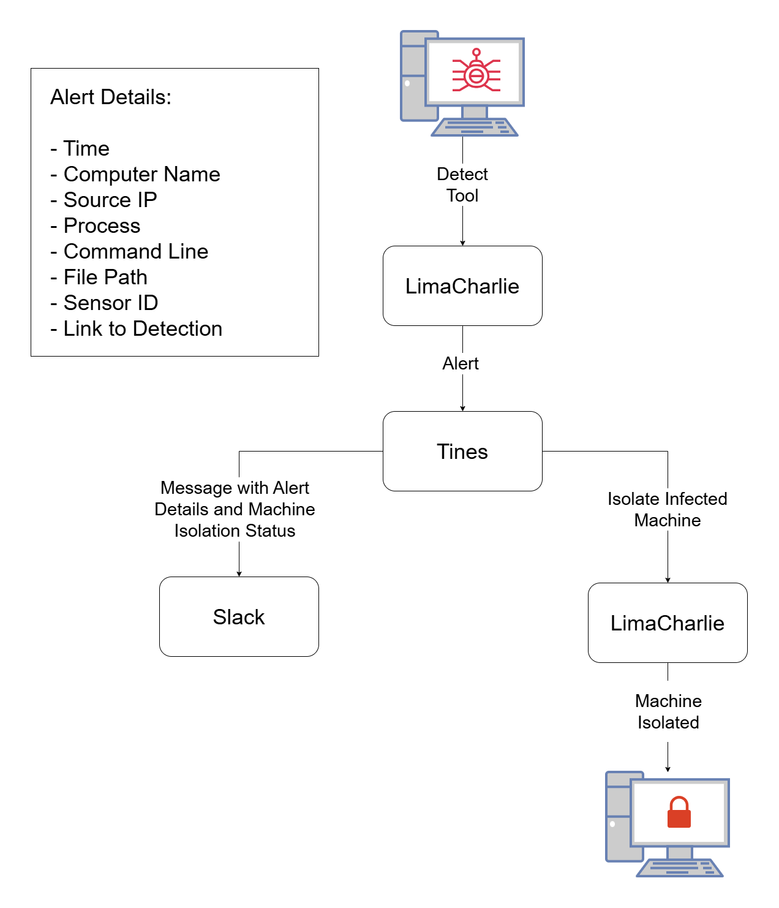
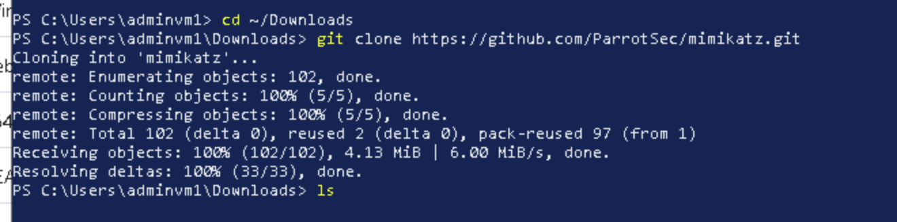
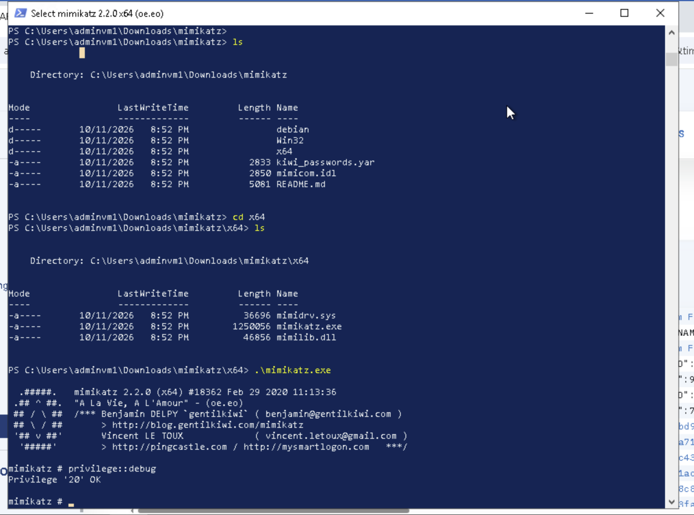
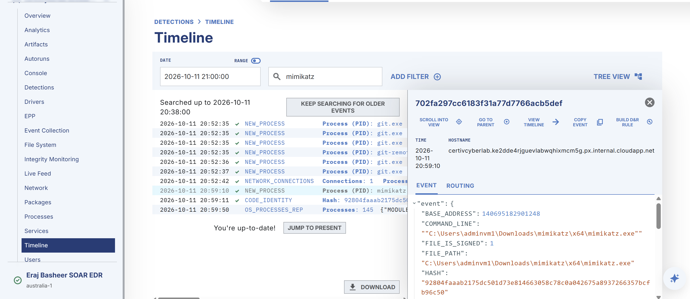
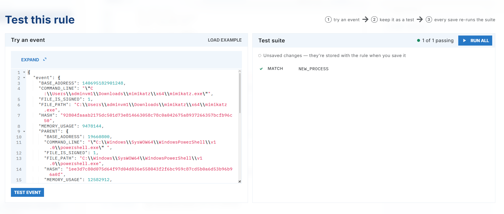
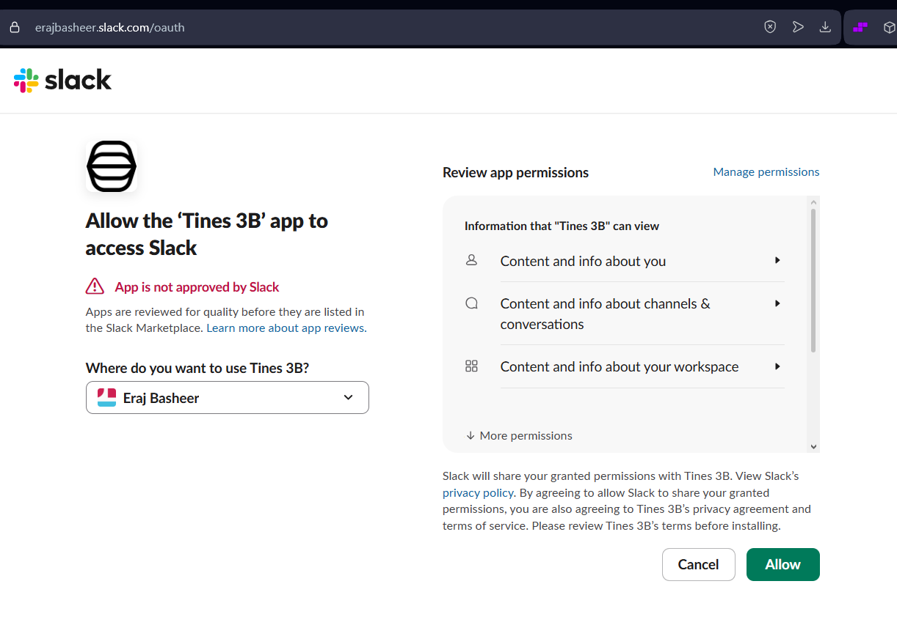
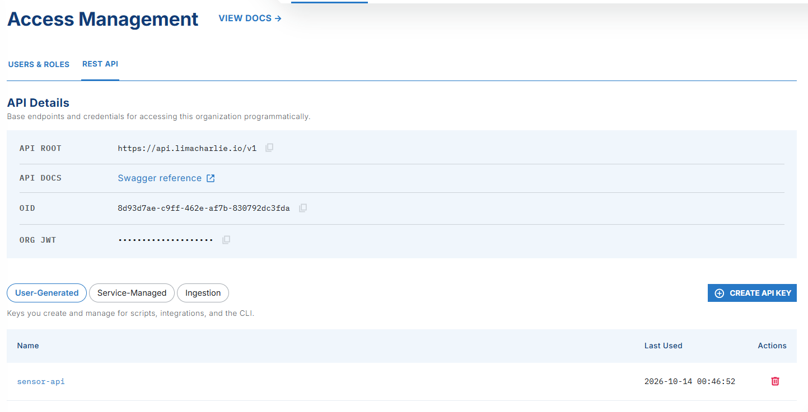
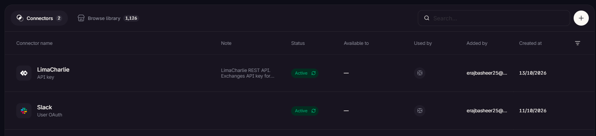
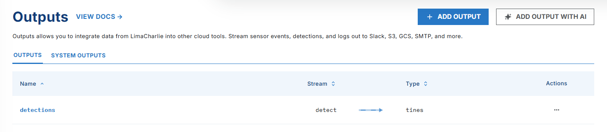
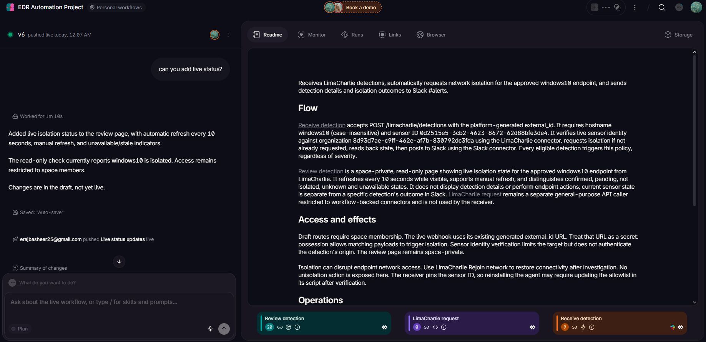

# LimaCharlie EDR and SOAR

## Overview 

This lab involved configurating a detection rule in LimaCharlie (EDR) in order to detect Mimikatz execution on a Windows endpoint, following which a playbook established in Tines recieves the alert information and automatically isolates the infected machine in LimaCharlie.

## Objectives 

- Setup LimaCharlie Organisation and connect Windows 10 Sensor
- Run Mimikatz and Create Detection and Response Rule for Mimikatz
- Create Slack Alerts channel
- Create Tines account and add Slack and LimaCharlie Connectors
- Create Tines workflow
- Test workflow


## Lab Diagram

 

--- 

## 1. LimaCharlie Setup

After creating a LimaCharlie account, create an organisation and enter in the relevant details. In order to attach the Windows 10 virtual machine as a sensor, click Add Sensor (on the Sensors page) and select the Windows sensor type. Select the organisation's Installation Key and run the powershell command given to add the sensor.


<br>

 
 
 
<br>

## 2. Mimikatz Detection 


In order to build and test the Detection and Response rule, we first need to generate telemetry related to Mimikatz. 

In a Windows 10 virtual machine environment, disable the antivirus and then use git to clone Mimikatz from the [offical repositiory](https://github.com/ParrotSec/mimikatz.git). After running Mimikatz, run the following commands:
<br>
``` 
privilege::debug
```

```
sekurlsa::logonPasswords
```
<br>

 
 
<br>

The event logs generated from running Mimikatz can be viewed by clicking the sensor attached earlier and then selecting the Timeline page. Search for Mimikatz to find related logs.

 
<br>

Based on the information gathered from the mimikatz event, we can build the Detection and Response rule. Open the detections page. Following LimaCharlie documentation, create and enable the following rule:

```
events:
  - NEW_PROCESS
  - EXISTING_PROCESS
op: and
rules:
  - op: is windows
  - op: or
    rules:
      - case sensitive: false
        op: ends with
        path: event/FILE_PATH
        value: mimikatz.exe

      - case sensitive: false
        op: contains
        path: event/COMMAND_LINE
        value: mimikatz

      - case sensitive: false
        op: is
        path: event/HASH
        value: '1ee3d7c80d075d64f97d04d036e558043f2f6bc959c87cd5b0a6d53b96b96a0f'

- action: report
  metadata:
    author: Eraj Basheer
    description: Detects potential Mimikatz execution
    falsepositives:
      - Security testing and lab simulations
    level: high
    tags:
      - attack.credential_access
      - attack.t1003
  name: Credential Dumper - Mimikatz

```
<br>


The detection and response rule can then be tested against the telemetry generated earlier. 

 


## 4. Tines Automation

### Slack Setup 

In order to recieve notifications in regards to alerts, setup of a Slack account is required. Create a Slack account and create a new channel named Alerts.


 

### Tines Setup

#### Slack Connector:

Create a Tines account. On the connectors page, add Slack and LimaCharlie as connectors. Connect the Slack Alerts channel using the Channel ID.

 
<br> 

#### LimaCharlie Connector:

For the LimaCharlie connector, API configuration will be required. On LimaCharlie, go to Access Management and then select Rest API. Create a new API Key and scroll down to the sensor premission. Select all read and write functions. Give the API Key a name and press Create. Copy the API Key and do not share anywhere publicly.

 

<br> 

In Tines, on Connectors page, add a custom API Key for the LimaCharlie connector. Configure settings following the table below:

| Field | Input |
|---|---|
| Name | LimaCharlie |
| Allowed for URLs starting with | api.limacharlie.io |
| Authentication method | Token exchange |
| Token URL | `https://jwt.limacharlie.io` |
| Body Format | Form encoded | 
| Body | oid  `<Your OID>`  <br> secret  `<API Key>` |
| Token path | jwt |
| Token lifetime | 3000 |
| Send the token as | Authorization: Bearer token | 
| Test URL | `https://api.limacharlie.io/v1/sensors/<Your OID>` |

<br> 

<br>

Test and confirm both connectors are active.

 


<br>

### Tines Workflow

To create the SOAR playbook, select personal workflows in Tines and describe the automation process to the Tines 3B AI tool. Attach the project diagram and use the following prompt:

``` Using the EDR diagram provided as reference, first create a Webhook from LimaCharlie to Tines and provide the destination host link. I will register an output linked to the address provided which will recieve detections from LimaCharlie. If a detection occurs, isolate the machine automatically and send a message to Slack. The message must be sent to the 'alerts' channel and must contain the alert details mentioned in the EDR Diagram. The slack message must also contain a webpage message that confirms the machine has been automatically isolated in LimaCharlie. ```

#### Ouput Configuration: 

In order for Tines to recieve detections from LimaCharlie, we first have to register an Output in LimaCharlie. Go to the Outputs page, add a new output and select Detections as the Output Stream. Select Tines as the destination, give the output a name and paste the destination host link provided by Tines. On the samples page, in order to generate a detection sample, re-run Mimikatz on the Windows 10 endpoint. Once the detection is recieved, save the Output. 


<br>

Follow steps provided by the 3B AI tool and push the draft live once finalised. Once published, test if the automation process is functioning as expected.

<br>

<br>

## 4. Testing

https://github.com/user-attachments/assets/ad1851ab-9e94-4e16-b6c4-e11b43fc1eba

<br>


## Conclusion


