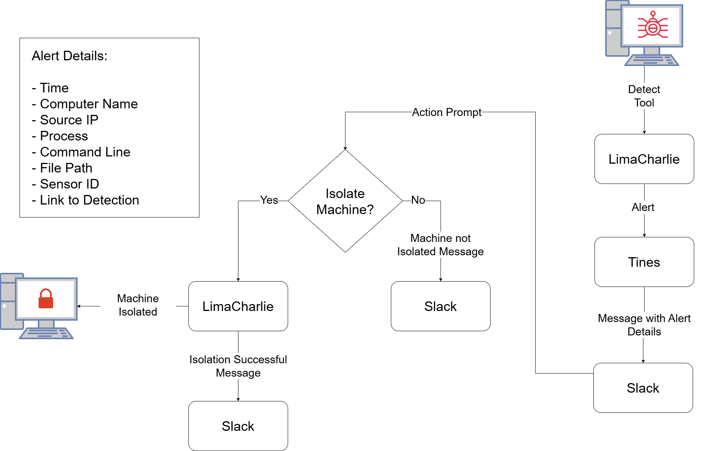
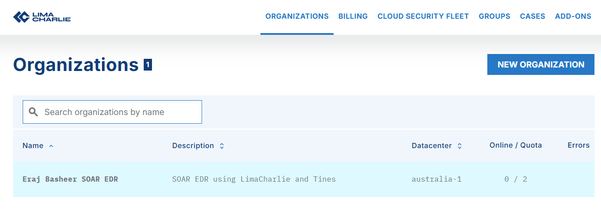
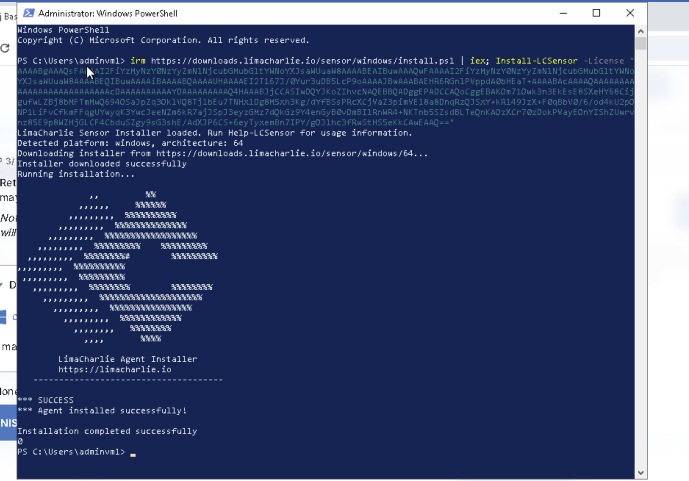
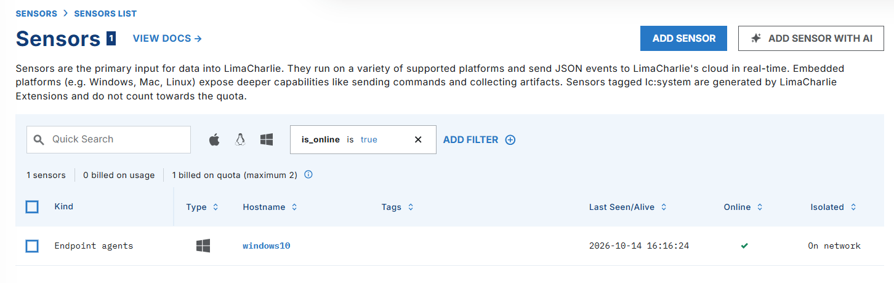

# LimaCharlie EDR and SOAR

## Overview 

This lab involved configurating a detection rule in LimaCharlie (EDR) in order to detect Mimikatz execution on a Windows endpoint, following which a playbook established in Tines recieves the alert information and sends a message to Slack with the details of the alert and a prompt which provides the option to isolate the machine, whereby the machine is automatically isolated by LimaCharlie.

## Objectives 

- Setup LimaCharlie Organisation and connect Windows 10 Sensor
- Run Mimikatz and Create Detection and Response Rule for Mimikatz
- Create Slack Alerts channel
- Create Tines account and add Slack and LimaCharlie Connectors
- Create Tines workflow
- Test workflow

## Lab Diagram

  

--- 

- Setup an organisation in LimaCharlie
- Connect the Windows 10 virtual machine sensor
- Run Mimikatz to generate sample event log
- Create Detection and Response Rule for Mimikatz
- Create Slack account
- Create a new channel in Slack for alerts
- Create Tines account
- Add LimaCharlie and Slack as Connectors in Tines
- Create new workflow in Tines
- Test workflow

## 1. LimaCharlie Setup

After creating a LimaCharlie account, create an organisation and enter in the relevant details. In order to attach the Windows 10 virtual machine as a sensor, click Add Sensor (on the Sensors page) and select the Windows sensor type. Select the organisation's Installation Key and run the powershell command given to add the sensor.

 
 
 

## 2. Mimikatz Detection 

Once the sensor is attached, live logs generated from the machine can be viewed by clicking the machine and then selecting the Timeline page.

In order to build the Detection and Response rule, we first need to generate telemetry related to Mimikatz. 

I used git to download Mimikatz from the [offical repositiory] (https://github.com/ParrotSec/mimikatz.git) 

 - run mimikatz
 - inspect log
 - create mimikatz detection alert
 - test alert?

## 3. Tines Automation

- create tines account
- create slack account and connect slack to tines
- take ss of ai making the automation

## 4. Testing

## Conclusion
